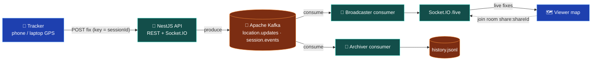

# kafka-live-tracker

A tiny app for **learning Apache Kafka** by building something real: a person shares
their phone's live GPS position, anyone with a link watches it move on a map.

The full plan lives in [`live-gps-tracker-plan.md`](./live-gps-tracker-plan.md).
Build decisions are recorded in [`DECISIONS.md`](./DECISIONS.md), Kafka observations in
[`LEARNINGS.md`](./LEARNINGS.md).

## Architecture



- `POST /api/sessions` creates a session, returns a **share link** and a secret
  `trackerToken` (the tracker's proof of ownership; viewers never see it).
- Every GPS fix is published to `location.updates` with **key = sessionId**, so all
  points of one trip land on the same partition and stay in order.
- Two **independent consumer groups** read the same data (fan-out):
  - `location-broadcaster` pushes fixes to viewers over Socket.IO room `share:{shareId}`
  - `location-archiver` appends the raw events to `backend/data/history.jsonl`
- `POST /api/sessions/:id/stop` publishes a `STOPPED` event on `session.events`;
  viewers immediately see "Tracking ended".
- While tracking, the phone screen stays **awake** (Screen Wake Lock, re-acquired
  when the tab becomes visible again), and the share panel renders a **QR code**
  of the link produced from `PUBLIC_APP_URL`.

## Run it

Prerequisites: Docker, Node 16+.

```bash
# 1. Kafka (single broker, KRaft mode)
docker compose up -d

# 2. Backend (terminal 1)
cd backend && npm install && npm run start:dev
# listens on http://localhost:3000/api (health: /api/health)

# 3. Frontend (terminal 2)
cd frontend && npm install && npm run dev
# open http://localhost:5173
```

`.env` files exist per app (`backend/.env.example`, `frontend/.env.example`) — copy
them to `.env` if you want different ports/origins. Defaults work out of the box.

### Try it on a desktop

1. Open `http://localhost:5173`, click **Start tracking** and allow location access.
2. Copy the share link into a second tab/window — you should see a marker appear
   (the page zooms to the first fix automatically).
3. Fudge your GPS: Chrome DevTools → ⋮ → More tools → **Sensors** → Location.
   The viewer tab updates within ~2–3 s.
4. Click **Stop tracking** — the viewer shows "Tracking ended".

> `navigator.geolocation` only works on **HTTPS** or **localhost**, and its
> accuracy depends on the **browser**, not this app:
> - Laptops have no GPS. Chrome/Edge/Firefox triangulate nearby **Wi-Fi access
>   points** (blocks-level accuracy — the same mechanism Google Maps uses).
>   **Brave** deliberately blocks that and serves **IP-only** location, which is
>   often kilometres off and identical on every website.
> - For real GPS, open the tracker **on a phone**: tunnel the frontend/API
>   (ngrok/cloudflared), point `VITE_API_URL`, `PUBLIC_APP_URL`, `CORS_ORIGIN`
>   at the HTTPS URLs, then scan the **QR code** shown next to the share link.

## Inspecting Kafka

```bash
docker exec -it kafka /opt/kafka/bin/kafka-topics.sh --bootstrap-server localhost:9092 --list

# watch live messages with key + partition
docker exec -it kafka /opt/kafka/bin/kafka-console-consumer.sh \
  --bootstrap-server localhost:9092 --topic location.updates \
  --property print.key=true --property print.partition=true

# consumer group state and lag
docker exec -it kafka /opt/kafka/bin/kafka-consumer-groups.sh \
  --bootstrap-server localhost:9092 --describe --group location-broadcaster
```

A tiny Socket.IO probe for the viewer path: `cd backend && node test-socket.js <shareId>`.

## REST API (base `/api`)

| Method | Path | Auth | Notes |
|---|---|---|---|
| POST | `/sessions` | – | returns `{ sessionId, shareId, trackerToken, shareUrl }` |
| POST | `/sessions/:sessionId/locations` | `x-tracker-token` | ≤ 1 fix/500 ms per session (429 otherwise), `202 Accepted` |
| POST | `/sessions/:sessionId/stop` | `x-tracker-token` | `409` once ended |
| GET | `/share/:shareId` | – | `{ status, lastLocation }`, `404` unknown |
| GET | `/health` | – | `{ ok: true }` |

## Kafka setup

| Topic | Partitions | Key | Retention |
|---|---|---|---|
| `location.updates` | 3 | `sessionId` | 1 h |
| `session.events` | 1 | `sessionId` | 1 d |

Topics are auto-created on boot (kafkajs admin). Consumers use `fromBeginning: false`
(a fresh group starts at the log end; afterwards it resumes from committed offsets).

## Test with real phone GPS (HTTPS tunnel)

Laptop browsers have no GPS and often return a static IP/Wi-Fi point kilometres
off (Brave even blocks Wi-Fi lookup by design). A phone browser uses **real GPS**.
`navigator.geolocation` only runs over **HTTPS**, so expose both apps through a
tunnel — cloudflared quick tunnels are free and need no account:

```bash
# terminal 1 — frontend tunnel
cloudflared tunnel --url http://localhost:5173
#    -> prints  https://<word-words>.trycloudflare.com      (WEB)

# terminal 2 — API tunnel
cloudflared tunnel --url http://localhost:3000
#    -> prints  https://<word-words>.trycloudflare.com      (API)
```

Then, for this run only (quick-tunnel URLs change every time):

```bash
# backend/.env — append the WEB tunnel URL to the existing list
CORS_ORIGIN=http://localhost:5173,...,https://WEB.trycloudflare.com
PUBLIC_APP_URL=https://WEB.trycloudflare.com

# frontend/.env.local — point the app at the API tunnel
VITE_API_URL=https://API.trycloudflare.com
```

Restart the backend and the frontend dev server, press **Start tracking** and
scan the **QR code** shown in the share panel — the session opens on your phone
and starts streaming metre-accurate fixes to your desktop viewer tab. Notes:

- Grant the phone browser's location prompt (iOS Safari "Allow while visiting",
  Android Chrome precise).
- The screen stays awake while the tracker page is open (Screen Wake Lock);
  a hidden/killed tab still pauses GPS — that is browser policy, not an app bug.
- Close the tunnels after testing.

## Limitations (known, intentional)

- **Single backend instance.** With several instances, each Socket.IO gateway only
  holds *its own* viewers, while partitions get split across the group members —
  so some viewers would miss some points. For scale-out you need one broadcaster
  group member per host (unique groupId) *plus* the Socket.IO Redis adapter, or
  simply one instance (here). See experiment 4 in `LEARNINGS.md`.
- Sessions live **in memory**: they vanish on restart (a Redis-backed store is
  sketched as Phase 8 in the plan; the `SessionStore` interface is ready for it).
  In-memory rate limiting resets on restart too.
- At-least-once delivery means duplicate/out-of-order WebSocket events are
  possible; the viewer drops them via `seq`.
- Location data is sensitive: a real product needs user consent, HTTPS, auth and a
  privacy policy before shipping anything like this.
- Browsers may stop sending fixes when a phone screen is off (Wake Lock API is a
  possible improvement).
